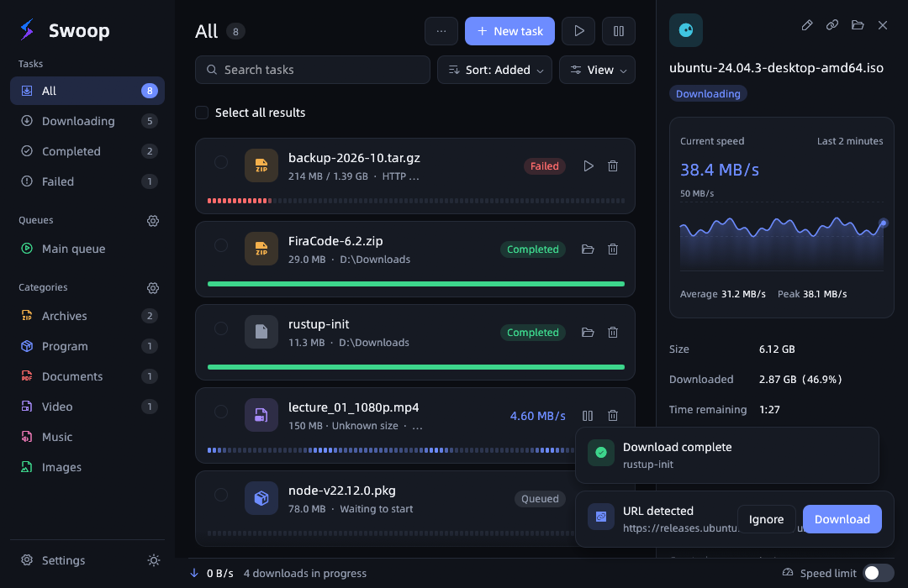

<p align="center">
  
</p>

<h1 align="center">Swoop</h1>

<p align="center"><strong>A fast, efficient, and lightweight download manager — written in Rust.</strong></p>

<p align="center">
  English · <a href="README.zh-CN.md">简体中文</a>
</p>

<p align="center">
  <a href="https://github.com/i-mufeng/muffin-swoop/releases/latest"></a>
  <a href="https://github.com/i-mufeng/muffin-swoop/actions/workflows/ci.yml"></a>
  <a href="LICENSE"></a>
  
  
</p>

<p align="center">
  <a href="https://github.com/i-mufeng/muffin-swoop/releases/latest"><strong>Download</strong></a> ·
  <a href="#features"><strong>Features</strong></a> ·
  <a href="#development"><strong>Development</strong></a> ·
  <a href="docs/"><strong>Docs</strong></a>
</p>

<p align="center">
  
</p>

Swoop is a native download manager built around a multi-connection download engine. It downloads ordinary files with no extra runtime, takes over downloads from your browser, records streams, and mirrors whole sites — all in one small, fast binary.

## Download

Grab the latest build from [GitHub Releases](https://github.com/i-mufeng/muffin-swoop/releases/latest):

| Platform | Package |
| --- | --- |
| macOS (Apple Silicon) | `.dmg` / signed update `.zip` |
| Windows (x64 / ARM64) | per-user NSIS installer |

- No installation privileges required — Swoop installs per user and stays out of your way.
- Windows packages are built natively on Windows and published with the release; they are not Authenticode-signed yet, so SmartScreen may warn on first run. Interactive desktop validation items remain open; see [desktop validation](docs/desktop-validation.md).
- **Signed auto-update** (Ed25519, stable/preview channels) built in; update source, public key, and check interval are configurable. See [updates](docs/updates.md).
- **FFmpeg is only needed for media downloads** (HLS/DASH/MMS). Ordinary file downloads run entirely on Swoop's own engine.

## Features

### Download engine

- **Multi-connection segmented downloads** — 8 connections by default, adjustable from 1 to 32 per task.
- **Dynamic segment rebalancing** — a connection that finishes early steals half of the largest remaining segment, so a single slow connection never holds the whole file hostage.
- **Resumable HTTP downloads** — per-segment progress is persisted continuously; pause, quit, and continue from the exact byte. Before resuming, Swoop re-validates ETag and file size and restarts cleanly if the remote file changed.
- **Safe in-place writes** — files are pre-allocated and written through `.swoop` temporary files; removing an unfinished task cleans up its partial data.
- **FTP / FTPS** with the same queues, speed limits, quotas, and name-collision handling as HTTP. See [FTP](docs/ftp.md).

### Media & sites

- **Stream recording** — HLS (including AES-128) and DRM-free DASH, with quality, audio-track, and subtitle selection; live recording with a duration cap; MMSH/MMST; remux to MP4/MKV via FFmpeg. Verified fragments are cached and reused. See [media](crates/media/README.md).
- **Site grabber** — mirrors HTML/CSS/SVG pages, media and subtitle references, and lazy-loaded images with domain/depth/type filters, robots.txt support, budget limits, and resumable projects. Dynamic pages can be rendered with an isolated Chromium instance. See [grabber](docs/grabber.md).

### Browser integration

- **Chromium & Firefox extension (MV3)** intercepts downloads *before* the browser's download panel appears — on Chromium at the filename-determination stage, with automatic fallback to the browser if Swoop can't take over. See [protocol & security](docs/browser-extension.md).
- **Passive media detection** records video/audio candidates on the page for you to pick; nothing downloads automatically.
- Right-click any link, image, or video to send it to Swoop; the popup lists all links on the current page.

### Organization & control

- **Named queues with a scheduler** — per-queue concurrency, task order, start/stop times, and periodic schedules, all persisted across restarts.
- **Categories** route files by extension or domain into the right folder (off by default).
- **Batch tools** — numeric/alphabetic URL ranges with dedup preview, text and shortcut-file import, native drag & drop of links and files, multi-select operations, and link export.
- **Speed limits** — token-bucket limiting, globally and per task, adjustable while running; download quotas shared per period.
- **Network policy** — connect/read/total timeouts, retries with backoff, HTTP(S)/SOCKS proxies with authentication, and per-site credentials (Basic, Digest, NTLM, Negotiate; session, account, or OS credential store). See [site auth](docs/site-auth.md) and [proxy auth](docs/proxy-auth.md).
- **Name collisions** — ask, overwrite, auto-rename, or cancel; overwrites are staged and only swapped in on success. See [file conflicts](docs/file-conflicts.md).

### Experience

- **Native UI** (egui + wgpu) with dark and light themes, card/table layouts, customizable columns and toolbar, and Simplified Chinese / English.
- **Detail panel** slides out per task: live speed graph (average/peak), resume support, and per-segment progress.
- **Menu bar / tray presence** — close the window and downloads keep running; the menu shows total speed and quick actions.
- **System notifications** for completion and failure (configurable, off when the window is focused), plus optional sound.
- **Completion actions** — scan, open file/folder, or a countdown to quit/shut down after everything finishes. See [completion actions](docs/completion-actions.md).
- **Single instance & CLI** — rerunning Swoop hands off to the existing window; `swoop-cli` manages files, media, grabber projects, and queues from a terminal. See [CLI](docs/cli.md).
- **Embedded CJK font subset** (~1.5 MB) so Chinese text renders identically on any system. See [font notice](assets/fonts/NOTICE.md).

## Project structure

```
crates/core     swoop-core      Download engine (pure library, no UI dependencies)
crates/app      swoop-app       egui desktop app + swoop-cli console
crates/media    swoop-media     HLS/DASH/MMS inspection and cancellable FFmpeg downloads
crates/grabber  swoop-grabber   Resumable site grabbing and offline mirroring
crates/ftp      swoop-ftp       Cancellable FTP/FTPS transport
crates/updater  swoop-updater   Signed updates, install, and recovery
crates/i18n     swoop-i18n      Desktop language resources (compile-time checked)
extension/      Chromium / Firefox MV3 extension (TypeScript + esbuild)
docs/           Design and validation docs
assets/         Brand assets, screenshots, embedded font subsets
scripts/        Packaging, installer, and font-subset tooling
```

## Development

Requires **Rust 1.95+** (eframe/egui 0.36 minimum).

```bash
cargo run -p swoop-app              # launch the app
cargo test --workspace --locked     # unit + local HTTP/FTP end-to-end tests
```

Useful switches when working on the UI (Windows: use `set` instead of `env` prefix):

```bash
SWOOP_DEMO=1 cargo run -p swoop-app                        # seed 8 fake tasks covering every state
SWOOP_THEME=light cargo run -p swoop-app                   # start in light theme
SWOOP_DATA_DIR=tmp/manual-check cargo run -p swoop-app     # isolated database for manual testing
scripts/screenshot.sh home dark out.png                    # capture any screen, then exit (demo data, temp dir)
```

Browser extension:

```bash
cd extension
npm install
npm run build       # Chromium -> dist/, Firefox -> dist-firefox/
npm test            # unit tests for pure functions
npm run package     # store-ready zips under target/packages/ (with .sha256)
```

CI runs tests and packaging on macOS and Windows for every push and pull request. Passing local fixture tests does **not** mean every website, media format, or enterprise environment is compatible — the [feature matrix](docs/idm-parity.md) records what is implemented and how it was validated.

## Configuration

Everything lives in a per-user SQLite database (WAL) under the platform's application-support directory; settings apply transactionally and are documented with defaults in [configuration](docs/configuration.md). Highlights:

| Setting | Default | When it takes effect |
| --- | --- | --- |
| Connections per task | 8 (1–32) | New tasks and resumes; running connections are untouched |
| Completion / failure notifications | On | Future events; pauses never notify |
| Notification timing | Background only | Optionally "always" |
| Notification sound | Off | Future system notifications |
| Post-download scan / open / dialog | Off | Future completed downloads |
| Quit / shut down when all done | Off (30 s countdown, cancellable) | After every job succeeds |

## Privacy notes

- The database lives only in your own user directory.
- Browser-submitted tasks store their request headers (including cookies) in the task table — required for resume — in plaintext within that local database.
- System notifications show the file name only; URLs and headers from errors stay inside the app.
- Per-site credentials can be kept in the OS credential store instead of the database.

## Contributing

Issues and pull requests are welcome. Before opening a PR:

```bash
cargo fmt --all -- --check
cargo test --workspace --locked
cd extension && npm test && npm run typecheck
```

## License

[MIT](LICENSE)
